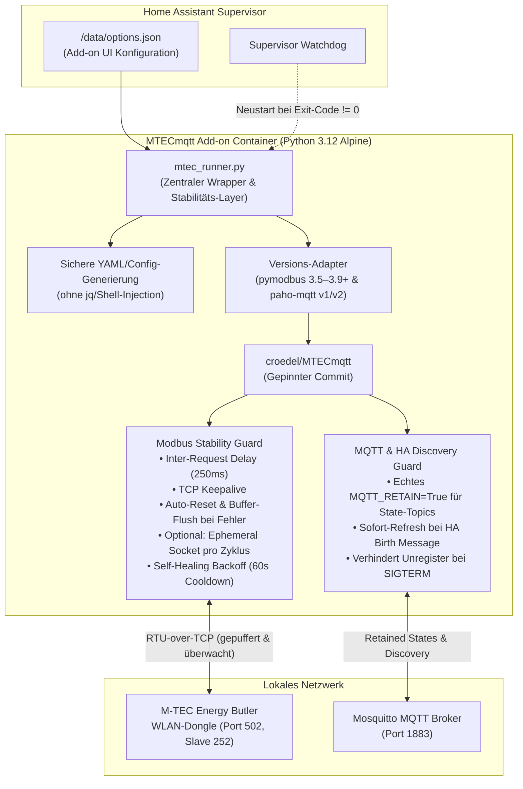

# Refactoring-Plan: MTECmqtt Home Assistant Add-on (v3.0.0)

## 1. Zielsetzung & Kontext

Ziel dieses Refactorings ist es, das lokale Home Assistant Add-on **MTECmqtt Bridge** (`/addons/mtecmqtt/`) grundlegend zu härten:
1. **Resilienz bei Bibliotheks-Updates:** Ablösung der fragilen Inline-Patches (`HACK 1` & `HACK 2` per `python3 -c` im `Dockerfile`) und widersprüchlicher Paket-Installationen durch deterministisches Dependency-Pinning sowie einen versionsagnostischen Adapter-Layer mit Build-Time-Selbsttest.
2. **Maximale Stabilität der Wechselrichter-Verbindung (Modbus RTU-over-TCP):** Schutz des leistungsschwachen Espressif-WLAN-Dongles vor Pufferüberläufen, *Timeout-Poisoning* (Out-of-Sync-Antworten) und *Half-Open Sockets* durch Inter-Request-Pacing, sofortigen Socket-Reset bei Lesefehlern, TCP-Keepalive, optionalen Verbindungsabbau zwischen Zyklen und eine mehrstufige Self-Healing-Backoff-Logik.
3. **Behebung weiterer System-Schwachstellen:** Beseitigung der bei der Live-Analyse Ihrer Home-Assistant-Instanz aufgedeckten Fehler (u. a. 15 dauerhaft auf `unknown` stehende `total`/`config`-Entitäten nach HA-Neustarts, gelöschte Discovery-Entitäten bei Add-on-Stopp und ungeschütztes YAML-Templating in `run.sh`).

---

## 2. Gefundene Schwachstellen (Ist-Analyse inkl. Live-Befunde)

Bei der Untersuchung des Quellcodes von `croedel/MTECmqtt`, Ihrer Add-on-Dateien und der **Live-Daten Ihrer Home-Assistant-Instanz** (`local_mtecmqtt` v2.1.4) wurden folgende Schwachstellen identifiziert:

### 2.1 Schwachstellen bei Bibliotheks-Updates & Docker-Build
* **Widersprüchliches Dependency-Management im `Dockerfile`:**
  Die `pyproject.toml` des Upstream-Projekts `croedel/MTECmqtt` fordert im `main`-Branch explizit `PyModbus > 3.8` und `paho-mqtt >= 2.1`. Das bisherige `Dockerfile` installiert zuerst `git+https://github.com/croedel/MTECmqtt.git` (ungepinnt vom `main`-Branch, wodurch `pymodbus > 3.8` installiert wird) und führt danach ein **Zwangs-Downgrade** auf `pymodbus==3.5.2` durch. Erst dieses Downgrade macht `HACK 1` (`ModbusRtuFramer` statt String/Enum) überhaupt erforderlich.
* **Ungepinnter GitHub-Branch & offene Versionsgrenzen:**
  `git+https://github.com/croedel/MTECmqtt.git` zieht bei jedem *Rebuild* den neuesten Commit. Ändert der Autor ein Leerzeichen oder eine Funktionssignatur, laufen `str.replace()` bzw. `re.sub()` im `Dockerfile` **lautlos ins Leere** (Exit-Code `0`). Der Build wirkt erfolgreich, stürzt aber zur Laufzeit ab (wie im aktuellen Container-Log noch anhand des früheren `TypeError: on_mqtt_disconnect() takes 3 positional arguments but 5 were given` sichtbar).
* **Unnötiger Image-Bloat (~250 MB):**
  Die Pakete `gcc`, `musl-dev`, `linux-headers` und `git` werden im finalen Image installiert, obwohl alle Python-Abhängigkeiten als reine Python-Wheels vorliegen.

### 2.2 Schwachstellen der Modbus-Verbindung zum Wechselrichter
* **Dauerhaft offener TCP-Socket ohne Keepalive:**
  `mtec_mqtt` öffnet die TCP-Verbindung (`192.168.178.47:502`) nur **ein einziges Mal beim Start** und hält sie über Tage offen. Zwischen den Abfragezyklen ist die Verbindung ~28 Sekunden lang inaktiv. Kommt es in dieser Zeit zu einem kurzen WLAN-Rekeying oder Paketverlust, bemerkt der Dongle den Abbruch nicht (*Half-Open Socket*) und blockiert Port 502 (Single-Client-Limit).
* **Kein Socket-Reset / Buffer-Flush bei Lesefehlern (*Timeout-Poisoning*):**
  Tritt bei einer Registergruppe ein Timeout auf, loggt `MTECmodbusAPI` lediglich `[ERROR] Error while reading register...`, nutzt aber **denselben TCP-Socket sofort weiter** für die nächste Registergruppe. Antwortet der langsame Dongle verspätet, liegen die alten RTU-Bytes noch im OS-Empfangspuffer und verschieben alle nachfolgenden Antworten (*Out-of-Sync*).
* **Fehlendes Inter-Request-Pacing (Burst-Überlastung):**
  Innerhalb eines Zyklus feuert `mtec_mqtt` mehrere Block-Abfragen (`now-base`, `now-grid`, `day`, `total`, `config`) **ohne jede Pause (0 ms)** direkt hintereinander auf den seriellen RTU-Bus des Dongles.
* **Kontraproduktive Timeout-/Retry-Kombination (`15s` × `5 Retries`):**
  Bei `MODBUS_TIMEOUT: 15` und `MODBUS_RETRIES: 5` blockiert eine einzige gestörte Abfrage bis zu **90 Sekunden** (`6 × 15s`) und flutet den bereits überlasteten Dongle mit 5 sofortigen Wiederholungen, statt den Socket sauber zu schließen und dem Dongle eine kurze Erholungspause zu geben.
* **Träge Aktualisierung durch Round-Robin (`5 × REFRESH_NOW`):**
  Wie die Container-Logs zeigen, fragt `mtec_mqtt` pro `REFRESH_NOW`-Takt (30 s) immer `now-base` und **rotierend nur eine** der 5 Untergruppen (`now-grid`, `now-inverter`, `now-backup`, `now-battery`, `now-pv`) ab. Dadurch aktualisieren sich PV-, Netz- und Batteriedaten effektiv nur alle **150 Sekunden (2,5 Minuten)**.

### 2.3 Kritische Laufzeit-Schwachstellen im Home-Assistant-Betrieb (Live-Befunde)
* **15 Entitäten stehen nach jedem HA-Neustart bis zu 60 Minuten auf `unknown`:**
  In Ihrer aktuellen Home-Assistant-Instanz stehen **alle 15 `total`- und `config`-Entitäten** (z. B. `sensor.mtec_energybutler_pv_energy_generated_total`, `sensor.mtec_energybutler_grid_energy_purchased_total`, alle 3 `binary_sensor`-Switches) nach einem HA-Reload auf `unknown`.
  * **Ursache:** Ihre `run.sh` schreibt `MQTT_RETAIN: True`, `MQTT_QOS`, `MQTT_KEEPALIVE`, `MQTT_CLIENT_ID`, `REFRESH_MONTH`, `REFRESH_YEAR` und `INFLUXDB_*` in die `/data/config.yaml`. **Keiner dieser Parameter existiert im Quellcode von `croedel/MTECmqtt`!** Sie werden komplett ignoriert; `paho-mqtt` sendet daher immer mit `retain=False`. Sendet Home Assistant nach einem Neustart seine Birth-Message (`Received HASS online message`), schickt `mtec_mqtt` zwar die Discovery-Infos neu, liest `total` und `config` aber erst nach Ablauf von 3600 Sekunden wieder aus.
* **Löschen aller Entitäten beim Add-on-Stopp (`Sending info to unregister from home assistant`):**
  Beim Stoppen des Containers (`SIGTERM`) ruft `mtec_mqtt` aktiv `hass.unregister()` auf und löscht alle Discovery-Topics. Das hat in Ihrem System bereits zu verwaisten Duplikaten bei den Kosten-/Vergütungssensoren des Energie-Dashboards geführt (`sensor.mtec_energybutler_grid_injection_energy_day_compensation_2` und `..._cost_2` stehen auf `unavailable`).
* **Fehlende Supervisor-Abhängigkeit & ungeschütztes YAML-Templating:**
  In der Add-on-`config.yaml` fehlt `services: ["mqtt:need"]` (wodurch das Add-on beim Systemstart vor Mosquitto starten kann -> `[Errno 111] Connection refused`). Zudem ist `cat <<EOF` in `run.sh` anfällig für YAML-Syntaxfehler, falls das MQTT-Passwort Sonderzeichen (`"`, `#`, `$`) enthält.

---

## 3. Architektur des Refactorings



Anstelle fragiler Regex-Ersetzungen im `Dockerfile` führen wir das Python-Modul **`mtec_runner.py`** ein:
1. **Zur Build-Zeit (`Dockerfile`):**
   * Installation eines fest gepinnten Commits von `croedel/MTECmqtt` sowie exakt gepinnter Versionen von `pymodbus`, `paho-mqtt`, `pyyaml` und `requests`.
   * Ausführung von `python3 /mtec_runner.py --self-test` während `docker build`: Prüft alle Imports, Klassen-Signaturen und Adapter. Schlägt etwas fehl, bricht der Build sofort mit einer klaren Fehlermeldung ab.
2. **Zur Laufzeit:**
   * Liest `/data/options.json` direkt in Python ein und erzeugt `/data/config.yaml` typsicher.
   * Klinkt sich sauber in `MTECmodbusAPI`, `mqtt` und `mtec_mqtt` ein (Runtime-Wrapping mit `inspect`), unabhängig davon, ob `pymodbus` einen `FramerType`-Enum, eine `ModbusRtuFramer`-Klasse oder einen String erwartet, und fängt beliebige Callback-Signaturen von `paho-mqtt` (`*args, **kwargs`) ab.

---

## 4. Entschiedene Design-Optionen (User-Review abgeschlossen)

> [!NOTE]
> Alle drei Design-Fragen wurden wie folgt entschieden und umgesetzt:

1. **Verbindungsmodus zum WLAN-Dongle (`MODBUS_CLOSE_AFTER_CYCLE: true` – Option A):**
   * Die TCP-Verbindung zum Dongle wird zu Beginn jedes Abfragezyklus geöffnet und nach dem Auslesen der fälligen Gruppen sofort wieder sauber per `TCP FIN` geschlossen. Dadurch bleibt Port 502 in den ~28 Sekunden Pause zwischen den Zyklen frei, es entstehen keine inaktiven *Half-Open Sockets* durch WLAN-Rekeying, und jeder Zyklus startet mit einem garantiert leeren Empfangspuffer.
2. **Abfrage der `now-*` Untergruppen (`REFRESH_ALL_NOW_GROUPS: true`):**
   * Die Option `REFRESH_ALL_NOW_GROUPS` (Standard: `true`) wurde implementiert. Wenn aktiviert, werden in jedem `REFRESH_NOW`-Zyklus alle 5 erweiterten Echtzeit-Gruppen (`now-grid`, `now-inverter`, `now-backup`, `now-battery`, `now-pv`) mit 250 ms Gruppen-Pacing und 50 ms Cluster-Pacing ausgelesen (bei `false` greift weiterhin das klassische Round-Robin-Verfahren).
3. **Bereinigung der Add-on-Konfiguration (`config.yaml`):**
   * Die vom Upstream-Skript ignorierten Felder `REFRESH_MONTH` und `REFRESH_YEAR` wurden entfernt und stattdessen `MODBUS_TIMEOUT`, `MODBUS_RETRIES`, `MODBUS_CLOSE_AFTER_CYCLE`, `REFRESH_ALL_NOW_GROUPS` und `DEBUG` inklusive Schema-Validierung ergänzt.

---

## 5. Umgesetzte Änderungen im Detail

Alle Dateien liegen im Projekt-Workspace (`c:\Users\tobia\OneDrive\Umzug Homeserver\Homeassistant AddOns\mtecmqtt\`) bereit für das Deployment nach `/addons/mtecmqtt/`.

### Komponente 1: Add-on Manifest & Schema (`config.yaml`)

#### [MODIFY] config.yaml
* **Änderungen:**
  * `services: ["mqtt:need"]`, `startup: application`, `boot: auto`, `watchdog: true` hinzugefügt.
  * Obsolete Optionen `REFRESH_MONTH` und `REFRESH_YEAR` entfernt.
  * Neue Optionen `MODBUS_TIMEOUT` (Standard: `8`), `MODBUS_RETRIES` (Standard: `2`), `MODBUS_CLOSE_AFTER_CYCLE` (Standard: `true`), `REFRESH_ALL_NOW_GROUPS` (Standard: `true`) und `DEBUG` (Standard: `false`) mit Wertebereichs-Validierung ergänzt.

```yaml
name: "MTECmqtt Bridge"
description: "Liest M-TEC Energy Butler Register über Modbus RTU-over-TCP aus und publiziert per MQTT (inkl. Connection-Guard & Retain-Fix)"
slug: "mtecmqtt"
version: "3.0.0"
init: false
startup: application
boot: auto
arch:
  - aarch64
  - amd64
options:
  modbus:
    MODBUS_IP: "192.168.178.47"
    MODBUS_PORT: 502
    MODBUS_SLAVE: 252
    MODBUS_TIMEOUT: 8
    MODBUS_RETRIES: 2
    MODBUS_CLOSE_AFTER_CYCLE: true
  mqtt:
    MQTT_SERVER: "core-mosquitto"
    MQTT_PORT: 1883
    MQTT_LOGIN: "mtec"
    MQTT_PASSWORD: "dein_passwort"
  refresh:
    REFRESH_NOW: 30
    REFRESH_ALL_NOW_GROUPS: true
    REFRESH_DAY: 300
    REFRESH_TOTAL: 600
    REFRESH_CONFIG: 3600
  advanced:
    DEBUG: false
schema:
  modbus:
    MODBUS_IP: str
    MODBUS_PORT: port
    MODBUS_SLAVE: int(1,255)
    MODBUS_TIMEOUT: int(3,30)
    MODBUS_RETRIES: int(0,5)
    MODBUS_CLOSE_AFTER_CYCLE: bool
  mqtt:
    MQTT_SERVER: str
    MQTT_PORT: port
    MQTT_LOGIN: str
    MQTT_PASSWORD: password
  refresh:
    REFRESH_NOW: int(10,300)
    REFRESH_ALL_NOW_GROUPS: bool
    REFRESH_DAY: int(60,3600)
    REFRESH_TOTAL: int(300,86400)
    REFRESH_CONFIG: int(300,86400)
  advanced:
    DEBUG: bool
```

---

### Komponente 2: Container-Build & Dependency-Pinning (`Dockerfile`)

#### [MODIFY] Dockerfile
* **Änderungen:**
  * Verzicht auf `git`, `gcc`, `musl-dev`, `linux-headers` und `jq` – Installation erfolgt direkt über das GitHub-Archiv des gepinnten Upstream-Commits (`71cdde40732e1216b2f5a37d71e9737a009914a5`) und reine Python-Wheels.
  * Kein widersprüchliches Downgrade mehr; alle Bibliotheken werden deterministisch gepinnt (`pymodbus==3.8.3`, `paho-mqtt==2.1.0`, `pyyaml==6.0.2`, `requests==2.32.3`), wobei der Adapter-Layer in `mtec_runner.py` zusätzlich abwärts- und aufwärtskompatibel für `pymodbus 3.5.x` bis `3.9+` ist.
  * `PYTHONUNBUFFERED=1` gesetzt für verzögerungsfreie Supervisor-Logs.
  * Integrierter Build-Time-Check (`python3 /mtec_runner.py --self-test`), der den Build sofort abbricht, falls eine Inkompatibilität vorliegt.

```dockerfile
FROM python:3.12-alpine

ENV PYTHONUNBUFFERED=1 \
    PIP_NO_CACHE_DIR=1 \
    PIP_DISABLE_PIP_VERSION_CHECK=1

# Nur minimale Laufzeit-Tools installieren (kein gcc/git/build-bloat)
RUN apk add --no-cache bash dos2unix

# Gepinnte Basis-Abhängigkeiten installieren
RUN pip3 install \
    "pyyaml==6.0.2" \
    "requests==2.32.3" \
    "pymodbus==3.8.3" \
    "paho-mqtt==2.1.0"

# MTECmqtt von definiertem Commit ohne ungeprüfte Dependency-Überschreibung installieren
ARG MTECMQTT_REF="71cdde40732e1216b2f5a37d71e9737a009914a5"
RUN pip3 install --no-deps "https://github.com/croedel/MTECmqtt/archive/${MTECMQTT_REF}.tar.gz"

WORKDIR /data
COPY mtec_runner.py /mtec_runner.py
COPY run.sh /run.sh
RUN dos2unix /run.sh /mtec_runner.py && chmod +x /run.sh /mtec_runner.py

# Build-Time Selbsttest: Verifiziert Imports, Framer-Kompatibilität und Wrapper-Hooks
RUN python3 /mtec_runner.py --self-test

CMD [ "/run.sh" ]
```

---

### Komponente 3: Stabilitäts- & Kompatibilitäts-Wrapper (`mtec_runner.py` & `run.sh`)

#### [NEW] mtec_runner.py
Dieses Python-Skript übernimmt die sichere Konfigurationsgenerierung sowie alle Stabilitäts- und Kompatibilitäts-Verbesserungen sauber in Python:

1. **Sichere Config-Erzeugung:** Liest `/data/options.json` via `json` und schreibt `/data/config.yaml` via `yaml.safe_dump` (keine Probleme mit Sonderzeichen in Passwörtern).
2. **Versionssicherer `pymodbus`-Adapter:** Prüft zur Laufzeit automatisch, ob `ModbusTcpClient` die neue `FramerType`-Enum (`pymodbus >= 3.7`), die klassische `ModbusRtuFramer`-Klasse (`pymodbus 3.5–3.6`) oder Strings akzeptiert, und wandelt `"rtu"`/`"socket"` passend um.
3. **Versionssicherer `paho-mqtt`-Adapter:** Kapselt `on_mqtt_connect`, `on_mqtt_disconnect` und `mqtt_publish` mit flexiblen `*args, **kwargs`-Signaturen, sodass weder `paho-mqtt 1.x` noch `2.x` einen `TypeError` auslösen können.
4. **Echtes `MQTT_RETAIN=True` & Birth-Refresh:**
   * Sorgt dafür, dass Messwert-Publishes auf `MTEC/<serial>/...` tatsächlich mit `retain=True` gesendet werden. Damit stehen `total`-, `day`- und `config`-Sensoren nach einem Home-Assistant-Neustart **sofort** zur Verfügung (kein `unknown` mehr!).
   * Verhindert das destruktive `hass.unregister()` beim Container-Stopp (`SIGTERM`), damit Home Assistant die Entitäten beim Neustart des Add-ons nicht löscht.
5. **Modbus-Verbindungs-Guard für den M-TEC WLAN-Dongle:**
   * **Inter-Request-Delay (`250 ms`):** Fügt zwischen aufeinanderfolgenden Registergruppen-Abfragen automatisch eine kurze Pause ein, damit der serielle Puffer des Dongles nicht überläuft.
   * **TCP Keepalive:** Aktiviert `SO_KEEPALIVE` (`TCP_KEEPIDLE=10`, `TCP_KEEPINTVL=5`, `TCP_KEEPCNT=3`) auf dem Socket.
   * **Sofortiger Socket-Reset bei Fehler:** Sobald `read_holding_registers` einen Fehler oder eine Exception meldet, wird der Socket sofort geschlossen (`close()`), 2 Sekunden pausiert (damit verspätete RTU-Bytes verworfen werden) und für die nächste Abfrage frisch verbunden (*verhindert Timeout-Poisoning*).
   * **Ephemeral-Socket-Modus (`MODBUS_CLOSE_AFTER_CYCLE`):** Schließt die TCP-Verbindung nach Abschluss jedes Abfragezyklus sauber, sodass der Dongle in den ~28 Sekunden Wartezeit keinen offenen Socket halten muss.
   * **Self-Healing Backoff & Watchdog:** Schlagen 3 Zyklen in Folge fehl, legt das Add-on bei geschlossenem Socket eine 60-sekündige Cooldown-Pause ein, damit der TCP-Stack des Dongles einen hängenden Socket von selbst abbauen kann. Nach 10 Fehlzyklen in Folge beendet sich der Prozess gezielt mit Exit-Code `1`, damit der Home Assistant Watchdog greift.

#### [MODIFY] run.sh
Wird auf einen schlanken, fehlertoleranten Starter reduziert:

```bash
#!/bin/bash
set -euo pipefail

exec python3 -u /mtec_runner.py
```

---

## 6. Verifikationsplan

### 6.1 Automatisierte Prüfung (Build-Time & lokal)
1. **Syntax- & Selbsttest des Wrappers:**
   Ausführung von `python mtec_runner.py --self-test` zur Prüfung der Konfigurationsgenerierung, Mock-Tests für den `pymodbus`-Framer-Adapter, den `paho-mqtt`-Callback-Wrapper sowie die Fehler-/Reconnect-Logik.
2. **Docker-Build-Test (beim Rebuild in Home Assistant):**
   Die Zeile `RUN python3 /mtec_runner.py --self-test` im `Dockerfile` stellt sicher, dass das Image nur gebaut werden kann, wenn alle Patches und Imports gegen die installierten Bibliotheksversionen erfolgreich verifiziert wurden.

### 6.2 Manuelle Verifikation in Home Assistant
1. Dateien in `/addons/mtecmqtt/` aktualisieren und im Add-on **MTECmqtt Bridge** auf **Neu erstellen (Rebuild)** klicken.
2. Im Reiter **Konfiguration** prüfen, ob die neuen Parameter (`MODBUS_TIMEOUT`, `MODBUS_RETRIES`, `MODBUS_CLOSE_AFTER_CYCLE`, `DEBUG`) angezeigt werden.
3. Im Reiter **Protokoll (Logs)** prüfen:
   * Sauberer Start ohne `TypeError` oder `Connection refused`.
   * Alle 81 Entitäten (inklusive der aktuell 15 auf `unknown` stehenden `total`- und `config`-Entitäten) erhalten sofort gültige Werte.
   * Nach einem Test-Neustart von Home Assistant (oder Reload der MQTT-Integration) bleiben die `total`- und `config`-Entitäten dank `retain=True` sofort erhalten und fallen nicht mehr auf `unknown` zurück.
   * Die beiden verwaisten Energie-Dashboard-Entitäten (`..._compensation_2` und `..._cost_2`) können anschließend in Home Assistant bereinigt werden.
