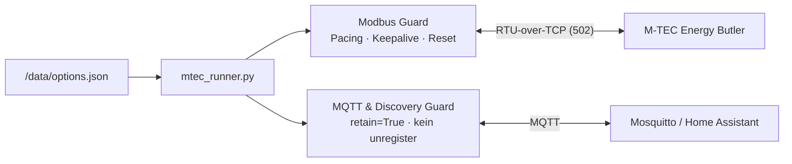

# Architektur & Hintergründe (v3.x)

Die App kapselt das Upstream-Projekt [croedel/MTECmqtt](https://github.com/croedel/MTECmqtt) in einem Python-Wrapper ([mtec_runner.py](../mtecmqtt/mtec_runner.py)), um typische Probleme im Dauerbetrieb mit dem M-TEC WLAN-/LAN-Dongle und Home Assistant zu beheben.

## Kernmechanismen

1. **Deterministische Abhängigkeiten & Build-Check:** Gepinnter Upstream-Commit (`71cdde40`) und feste Wheel-Versionen (`pymodbus==3.8.3`, `paho-mqtt==2.1.0`) ohne `gcc`/`git` im Image. Während des Docker-Builds prüft `python3 /mtec_runner.py --self-test` Adapter, Decoder und Discovery-Payloads.
2. **Modbus Stability Guard:**
   - **Pacing (`50 ms` Cluster / `250 ms` Gruppen):** Schützt den seriellen UART-Puffer des Dongles vor Bursts.
   - **Ephemeral Socket (`MODBUS_CLOSE_AFTER_CYCLE`):** Schließt Port `502` nach jedem Zyklus per `TCP FIN` gegen *Half-Open Sockets*.
   - **Socket-Reset & Backoff:** Trennt bei Lesefehlern sofort gegen *Timeout-Poisoning*; nach 3 Fehlzyklen 60 s Cooldown, nach 10 Fehlzyklen Exit-Code `1` für den Supervisor-Watchdog.
3. **Read-Only Register-Layer ([registers_extended.yaml](../mtecmqtt/registers_extended.yaml)):** Erweitert die Registermap strikt lesend (`FC 0x03`) auf 173 Entitäten, behebt den Upstream-`STR`-Slicing-Bug, sortiert Cluster numerisch (max. 45 Register/Frame ohne Lückenüberbrückung) und filtert `0xFFFF`-Sentinels nur bei `U16`/`U32`.
4. **MQTT & HA Discovery Guard:** Typsichere YAML-Erzeugung (sonderzeichensicher), echtes `retain=True` (keine `unknown`-Entitäten nach HA-Neustart), Sofort-Refresh bei HA-Birth-Message und Unterdrückung von `hass.unregister()` bei `SIGTERM`.
